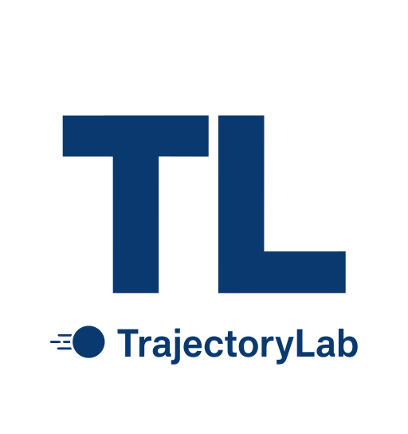

# TrajectoryLab 0.4.2 — Public Preview




TrajectoryLab is a local scientific desktop application for reproducible, low-speed
experiments involving spherical particles. The numerical core is independent from
the Qt interface and uses SI `float` values; Pint validates physical quantities at
the application and file-input boundary.

## Public preview status

This is a public preview, not a stable 1.0.0 release. The original TrajectoryLab
source code and project-authored documentation are licensed under the [MIT
License](LICENSE), subject to the scope exclusions in
[`LICENSE_SCOPE.md`](LICENSE_SCOPE.md). Third-party dependencies and artwork
retain separate terms; see [`THIRD_PARTY_NOTICES.md`](THIRD_PARTY_NOTICES.md)
and [`ASSET_RIGHTS.md`](ASSET_RIGHTS.md). The logo and cow easter-egg photo are
retained in this package but are excluded from MIT; confirm their redistribution
permissions before making the repository public.

## Windows quick start — no Python required

1. Download `TrajectoryLab_Windows_Builder_Package.zip` from the GitHub Releases page.
2. Extract the complete package into a writable folder.
3. Double-click `build.exe`.
4. On first start, Builder downloads the official Python 3.14.10 Windows x64
   installer from python.org, verifies its pinned SHA-256, and installs a private
   runtime under `%LOCALAPPDATA%\TrajectoryLabBuilder`. No administrator
   privileges or system PATH changes are required.
5. Builder opens a single compact RU/EN graphical window. Choose the language
   with the UK/Russian flag buttons and press **BUILD TRAJECTORYLAB**.
6. It installs project dependencies in a private virtual environment, runs the
   scientific test suite, scans selected source formats for common accidental
   secret patterns, packages the Qt application with PyInstaller, and performs
   a GUI smoke test.
7. Choose Light, Dark or Soft Pink in the same Builder window. Builder creates
   and verifies `TrajectoryLab.lnk` in the actual Windows Desktop known folder.

An internet connection is required on first launch for the Python runtime and
PyPI packages. The installer is executed only after SHA-256 verification.

For source development, install Python 3.11+ and run `python build.py`; this
opens the same graphical build interface. The source repository intentionally
does not track the compiled `build.exe`; that binary is attached to GitHub
Releases together with the complete Windows Builder package.

## Desktop application

- Classic scientific `QMainWindow` layout with compact dock panels, menu bar,
  toolbar, status bar, fixed-precision tables and a timestamped journal.
- 2D trajectory, OpenGL 3D view, speed/Mach/kinetic-energy charts and sample table.
- Light, Dark and **Soft Pink** QSS themes. Pink is a restrained pastel accent;
  the UI remains dense and technical, with no gradients, shadows or decorative
  cards.
- Runtime RU/EN interface language switching.
- `Help → User Manual (RU)` and `Help → User Manual (EN)` open the bundled PDF
  manuals.
- `Help → About` contains the `pomidorkmen` signature. Click it nine times to reveal the project's original cow easter egg.
- PDF report export asks for Russian, English or bilingual output. Unicode fonts
  are used for Cyrillic; the report includes model and trajectory hashes,
  parameters, integration settings and provenance.
- The bundled RU and EN user manuals contain 35 pages each and document the
  main panels, controls, examples, exports, model manager, plugin safety and
  troubleshooting workflows.
- Settings, logs and user models are stored in the current user's profile under
  `.trajectory_lab`; these files are not part of the application archive.

## Scientific scope

The model describes translational motion of a rigid spherical particle. It does
not model orientation, spin, lift, deformation, added mass, Basset history force,
wall effects, particle interactions or non-Newtonian fluids. Included atmosphere
models return density, temperature, dynamic viscosity and speed of sound. Drag
correlations have explicit applicability ranges; read `docs/physics.md`.

## Simulation time and stopping conditions

The **Maximum simulation time** field is an upper bound. With **Stop when
descending through y = 0** enabled, RK4 and DOP853 stop at the first downward
ground-plane crossing and localize the event between output samples. If the
checkbox is disabled, the run continues to the maximum time. A final partial
step is used when the output step does not divide the maximum time. Maximum
height is interpolated between stored samples; for variable acceleration this
is a local Hermite approximation.

## User drag models and security

Declarative JSON/CSV Cd(Re) tables are data and do not execute Python. They are
preferred for user-provided tabular models. Python plugins execute arbitrary
code with the current user's permissions and are **not sandboxed**. The UI asks
for confirmation; the CLI does not load Python plugins by default. The explicit
`--allow-python-plugins` flag should only be used after reviewing every source
file. Never run TrajectoryLab as Administrator merely to load a plugin.

Builder scans selected source formats (including SVG/XML) for several common
secret patterns and private-key filenames, but this is not a complete security
audit. It does not scan all binary formats or prior Git history. Review the
source, dependencies and complete Git history before publishing. Dependencies
are installed from PyPI; package hashes are not currently pinned in a complete
hash-locked requirements file. See `SECURITY.md`, `docs/release_readiness.md`, and `RELEASE_CHECKLIST.md` for privacy boundaries and remaining hardening work.

## Security and privacy policy

Read [`SECURITY.md`](SECURITY.md) for data locations, Builder network traffic, plugin trust boundaries and safe sharing practices. The current source review is in `docs/security_audit_0_4_2.md`.

## CLI examples

```powershell
python -m trajectory_lab --help
python -m trajectory_lab run examples/vacuum_reference.json
python -m trajectory_lab run examples/air_resistance_drop.json
python -m trajectory_lab run examples/tabular_reference.json
python -m trajectory_lab verify trajectory_result.json
```

## Source development

```powershell
python -m pip install -e ".[dev,build]"
python -m pytest -q
ruff check .
mypy trajectory_lab
```

## Release contents

- `tools/builder/main_windows.go`: source of the Windows x64 bootstrapper; the compiled `build.exe` is distributed as a GitHub Release asset.
- `build.py`: single-window Python/Tk Builder with RU/EN flags, progress journal and in-window theme selection.
- `trajectory_lab/`: application and independent scientific core.
- `trajectory_lab/ui/resources/manuals/`: Russian and English PDF manuals.
- `docs/`: architecture, physical assumptions, security and release notes.
- `tools/generate_manuals.py`: source used to generate the bundled manuals.

The Windows bootstrapper is distributed as a GitHub Release asset, not tracked in the source repository. It is a Windows x64 binary. Building it from source requires Go; ordinary users do not need Go or Python installed. See `GITHUB_PUBLISH_GUIDE.md`.

## Project files for publication

- `LICENSE`: MIT License for original project source and authored documentation.
- `LICENSE_SCOPE.md`: explicit exclusions for third-party assets and dependencies.
- `LICENSE_SCOPE.md`: assets and dependencies excluded from the MIT grant.
- `LICENSE_STATUS.md`: current project-license decision.
- `THIRD_PARTY_NOTICES.md`: upstream dependency licensing information.
- `ASSET_RIGHTS.md`: provenance and redistribution notes for bundled artwork.
- `GITHUB_PUBLISH_GUIDE.md`: instructions for publishing this local Git repository.
- `RELEASE_CHECKLIST.md`: remaining acceptance tasks.
